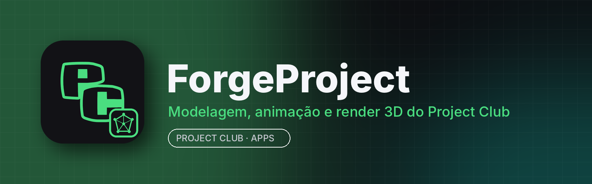

<p align="center"></p>

# ForgeProject

**ForgeProject** é o estúdio **3D** do **Project Club**: modelagem, escultura, UV, pintura de texturas, materiais, animação, simulação, render (Cycles e EEVEE), composição e edição de vídeo — tudo num só app, com o tema do Project Club e integrado à aba **Apps**.

É uma versão modificada do **[Bforartists](https://www.bforartists.de)**, que por sua vez é baseado no **[Blender](https://www.blender.org)** (ambos código aberto, GNU GPL). Todos os recursos continuam aqui; o ForgeProject troca o nome, o ícone, a tela de abertura, o tema e a integração com o Project Club.

## Principais recursos

- Modelagem poligonal, modificadores, nós de geometria e escultura
- UV, pintura de texturas e materiais por nós
- Animação com esqueleto, restrições, keyframes e editor de gráficos
- Render Cycles (path tracing) e EEVEE (tempo real)
- Física: tecido, fluidos, partículas, corpos rígidos
- Grease Pencil para desenho 2D/3D
- Composição e editor de vídeo
- Importa/exporta FBX, OBJ, glTF, USD, STL, Alembic
- Interface do Bforartists (ícones, barras de ferramentas) com tema escuro do Project Club (destaque verde)

## Instalar

Pelo **Project Club**: aba **Apps → ForgeProject → Instalar**. Manual: [Releases](../../releases/latest)
- **Windows 10/11 (64 bits):** `ForgeProject-<versão>-win.zip` → extraia e abra `ForgeProject.exe`
- **Linux (x86_64):** `ForgeProject.AppImage` → `chmod +x` e execute

## Requisitos

| | Mínimo | Recomendado |
|---|---|---|
| Sistema | Windows 10 64 bits / Linux x86_64 (glibc 2.28+) | Windows 11 / Ubuntu 22.04+ |
| CPU | 4 núcleos com SSE4.2 | 8+ núcleos |
| RAM | 8 GB (o app usa ~0,5–2 GB; cenas grandes muito mais) | 16–32 GB |
| GPU | OpenGL 4.3, 2 GB de VRAM | 8 GB de VRAM (NVIDIA RTX / AMD RDNA2 para Cycles na GPU) |
| Disco | ~1,2 GB + projetos | SSD |

## Compilar

Igual ao Bforartists/Blender: veja [developer.blender.org](https://developer.blender.org/docs/handbook/building_blender/). Resumo:

```bash
git lfs install
git clone https://github.com/RiqueBitt/ForgeProject && cd ForgeProject
git remote add upstream https://github.com/Bforartists/Bforartists.git
git lfs fetch upstream HEAD && git lfs checkout      # arquivos grandes vêm do Bforartists
python build_files/utils/make_update.py --no-blender  # bibliotecas pré-compiladas
cmake -B build -DCMAKE_BUILD_TYPE=Release && cmake --build build -j
```

O workflow **Build ForgeProject release** gera os pacotes do Project Club, as capturas de tela e a release.

## Créditos e licença

ForgeProject é uma versão modificada do **Bforartists** (© equipe Bforartists) e do **Blender** (© Blender Foundation e colaboradores), distribuída sob a **GNU General Public License** — veja [COPYING](COPYING) e [AUTHORS](AUTHORS). Blender® é marca registrada da Blender Foundation; o ForgeProject não é afiliado nem endossado pela Blender Foundation nem pela equipe Bforartists. O código-fonte completo com as modificações está neste repositório.
